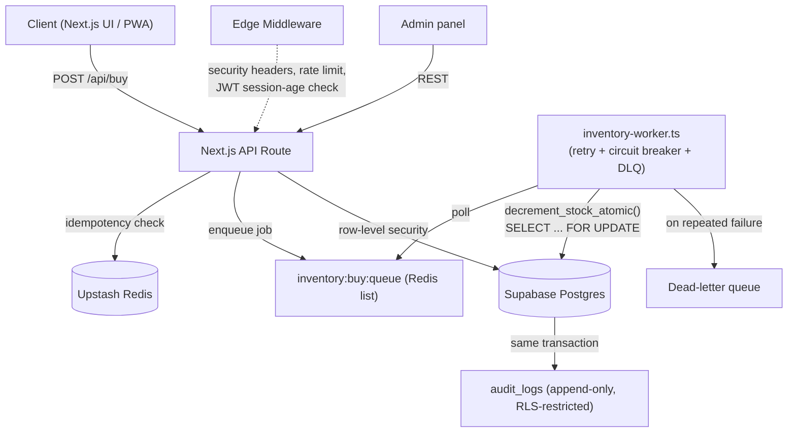

# FurnitureOps

[](https://github.com/Rexy-5097/FurnitureOps/actions)
[](https://www.typescriptlang.org/)
[](https://nextjs.org/)
[](LICENSE)
[](https://furniture-ops.vercel.app)

Inventory management backend built around a single hard constraint: stock counts must stay correct under concurrent purchases, retried requests, and partial failures. Everything else in the system — the queue, the locking, the audit trail — exists in service of that one guarantee.

---

## Overview

FurnitureOps is a Next.js application for managing a furniture inventory: item catalog, stock levels, and an admin panel for inventory control and audit review. It was built to explore a specific backend problem: how to keep multi-writer stock decrements correct — no oversells, no lost updates — while an asynchronous queue sits between the request and the database.

**Problem.** A naive `UPDATE inventory SET quantity = quantity - 1` under concurrent requests is a race condition: two buyers can both read the same stock count and both succeed, oversetting the shop's actual inventory. Handling this at the API layer alone (e.g. optimistic locking in application code) does not survive retries, duplicate requests, or a crashed worker mid-transaction.

**Approach.** Purchase requests are accepted at the edge, checked for idempotency, and pushed onto a Redis-backed queue rather than written synchronously. A separate worker process consumes that queue and applies stock changes through a Postgres RPC (`decrement_stock_atomic`) that row-locks the item (`SELECT ... FOR UPDATE`), validates available stock, and writes an audit log entry in the same transaction. The worker adds retries, a circuit breaker against a struggling database, and a dead-letter queue for jobs that exhaust their retries.

## Architecture



Edge middleware (`src/middleware.ts`) applies security headers (CSP, HSTS, frame/DNS protections) to every response, rate-limits `/api/admin`, `/api/inventory`, and `/api/auth` via Upstash Redis (fails open with a logged warning if Redis is unreachable), and rejects admin requests carrying a JWT older than 30 minutes.

## Folder Structure

```
FurnitureOps/
├── src/
│   ├── app/
│   │   ├── api/            # Route handlers: auth, inventory, buy, admin
│   │   ├── dashboard/       # Inventory dashboard UI
│   │   ├── admin/           # Admin panel + audit log viewer
│   │   └── login/           # Auth entry point
│   ├── components/          # React components
│   ├── lib/                 # Supabase clients, rate limiter, logger, idempotency
│   ├── providers/           # React context providers
│   └── middleware.ts        # Edge security + rate limiting
├── scripts/
│   ├── inventory-worker.ts  # Queue consumer (retries, circuit breaker, DLQ)
│   ├── test-*.ts            # Concurrency, idempotency, RLS, security scripts
│   └── lib/
├── supabase/                # SQL schema, RLS policies, RPC functions
├── tests/                   # Playwright e2e + chaos/concurrency test plans
├── docs/                    # Design notes and internal engineering logs
└── electron/                # Desktop shell (Capacitor/Electron packaging)
```

## Technology Stack

| Layer | Technology |
|---|---|
| Frontend | Next.js 14 (App Router), React 18, Tailwind CSS |
| Backend | Next.js Route Handlers (Node + Edge runtimes) |
| Database | Supabase (PostgreSQL) with Row Level Security |
| Queue / Cache | Upstash Redis (rate limiting, job queue, idempotency locks) |
| Auth | Supabase Auth (JWT-based sessions) |
| Packaging | Capacitor (Android), Electron (desktop) |
| Testing | Playwright, custom concurrency/chaos scripts |
| Deployment | Vercel |

## Features

- **Atomic stock updates** — all inventory decrements go through a single Postgres RPC that row-locks the item and rejects overselling, rather than relying on application-level checks.
- **Asynchronous purchase queue** — `/api/buy` enqueues a job instead of writing synchronously; a dedicated worker processes it with retries, a circuit breaker, and a dead-letter queue for jobs that repeatedly fail.
- **Idempotency guarantees** — duplicate requests (retries, double-clicks) are deduplicated via a Redis-backed idempotency key before they reach the queue.
- **Row Level Security** — Postgres RLS policies separate "authenticated read" from "admin write" at the database layer, not just in application code.
- **Append-only audit log** — every stock mutation and admin action (including the kill-switch) writes an audit record; RLS revokes `UPDATE`/`DELETE` on the table entirely.
- **Admin kill-switch** — an RPC-gated emergency action to clear inventory, restricted to accounts in the `admins` table and logged with actor and IP.
- **Edge-level hardening** — CSP, HSTS, and related security headers on every response; distributed rate limiting; JWT session-age enforcement for admin routes.

## Screenshots

Not included yet. To add:
- Dashboard view showing the inventory list and stock levels
- Admin panel: audit log viewer
- Admin panel: kill-switch confirmation flow
- Mobile (Capacitor) build running on a device or emulator

## Installation

### Prerequisites
- Node.js 20+
- pnpm 9+
- A Supabase project (Postgres + Auth + Storage)
- An Upstash Redis database

### Setup

```bash
git clone https://github.com/Rexy-5097/FurnitureOps.git
cd FurnitureOps
pnpm install
```

Apply the database schema and RLS policies in `supabase/` (in order: `schema.sql`, then the `*_hardening.sql` and RPC files) via the Supabase SQL editor or CLI.

### Environment Variables

Copy `.env.example` to `.env.local` and fill in real values:

```bash
NEXT_PUBLIC_SUPABASE_URL=https://your-project.supabase.co
NEXT_PUBLIC_SUPABASE_ANON_KEY=your-anon-key
SUPABASE_SERVICE_ROLE_KEY=your-service-role-key
SUPABASE_JWT_SECRET=your-jwt-secret
UPSTASH_REDIS_REST_URL=https://your-redis.upstash.io
UPSTASH_REDIS_REST_TOKEN=your-redis-token
```

### Running locally

```bash
pnpm dev          # Next.js app on http://localhost:3000
pnpm exec tsx scripts/inventory-worker.ts   # queue consumer, run separately
```

## API Reference

| Method | Route | Description |
|---|---|---|
| `GET` | `/api/inventory` | List inventory items |
| `POST` | `/api/inventory` | Create an inventory item (admin) |
| `PATCH` | `/api/inventory/[id]` | Update an item (admin) |
| `DELETE` | `/api/inventory/[id]` | Remove an item (admin) |
| `POST` | `/api/buy` | Enqueue a purchase (idempotent) |
| `POST` | `/api/auth/login` | Email/password sign-in via Supabase Auth |
| `GET` | `/api/admin/audit-logs` | Read audit log entries (admin) |
| `POST` | `/api/admin/kill-switch` | Clear all inventory (admin, audited) |

## Database Schema

Core tables, defined in `supabase/schema.sql`:

- **`inventory`** — `id`, `name`, `origin`, `price`, `quantity_available`, `quantity_sold`, `image_url`, timestamps. Check constraints enforce non-negative stock.
- **`admins`** — allow-list of user IDs granted write access; referenced by every RLS write policy.
- **`audit_logs`** — append-only (`INSERT`-only via RLS), records action, actor, and structured JSON detail for every mutation.

## Testing

- `scripts/test-concurrency.ts`, `scripts/test-idempotency.ts` — correctness under concurrent/duplicate requests.
- `scripts/test-rls.ts`, `scripts/test-security.ts` — verifies Row Level Security policies and access boundaries.
- `tests/chaos_worker_crash.js`, `tests/replay_attack.js` — failure-injection scenarios for the worker and queue.
- `tests/e2e.spec.ts` — Playwright end-to-end coverage of the UI.

These scripts exist in the repository and are runnable locally against a configured Supabase/Redis instance; no benchmark numbers are published here since they haven't been captured in a reproducible, checked-in form.

## Roadmap

- Deploy the queue worker as a persistent process (currently run manually / locally) rather than an on-demand script.
- Replace the manual `admins` allow-list with role claims managed through Supabase Auth.
- Add structured metrics/tracing around the queue and worker, rather than console logging.

## Contributing

See [CONTRIBUTING.md](CONTRIBUTING.md). Security issues should be reported per [SECURITY.md](SECURITY.md) rather than filed as public issues.

## License

MIT — see [LICENSE](LICENSE).
